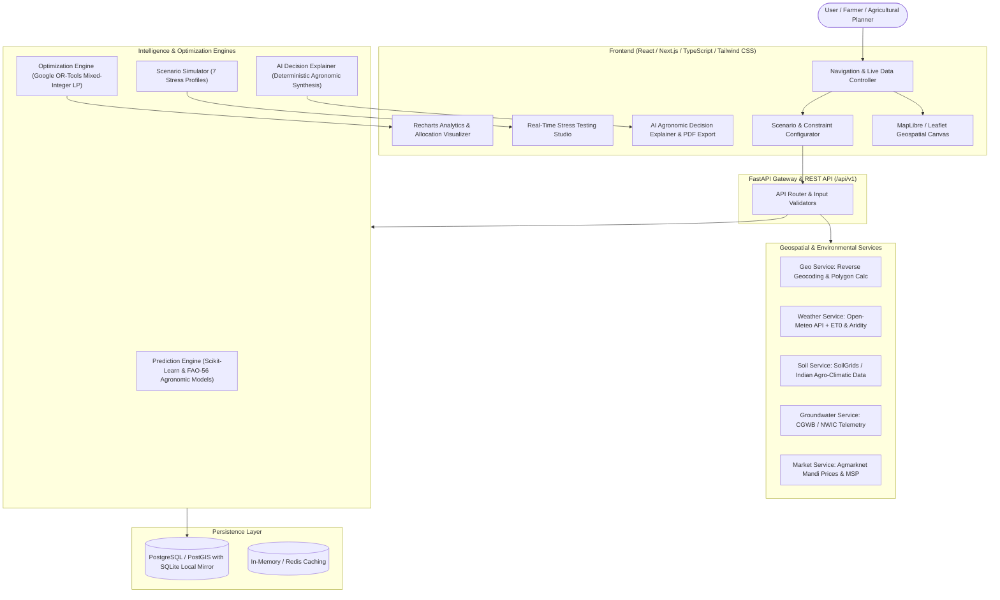

# AquaShift 2.0 — Architecture & Technical Specification

> **Platform Mission**: "Machine Learning predicts. Mathematical Optimization decides. Geospatial Intelligence contextualizes. AI explains."

---

## 1. System Architecture Overview

AquaShift 2.0 is an enterprise-grade agricultural decision-intelligence and geospatial optimization platform. It bridges the gap between raw agronomic/remote sensing data and optimal resource allocation decisions.

---

## 2. Mathematical Optimization Formulation (Google OR-Tools)

The core optimization problem allocates total field acreage $A$ among candidate crops $C = \{1, \dots, n\}$.

### 2.1 Decision Variables
- $x_c \ge 0$: Area (in hectares) allocated to crop $c$.
- $s_{\text{food}} \ge 0$: Slack variable representing food-production shortfall (metric tonnes).
- $s_{\text{income}} \ge 0$: Slack variable representing net income shortfall (currency units, ₹).
- $s_{\text{water}} \ge 0$: Slack variable representing irrigation water shortfall ($m^3$).

### 2.2 Hard Physical Constraints
1. **Total Land Conservation**:
   $$\sum_{c \in C} x_c \le A_{\text{total}}$$
2. **Non-Negativity & Agronomic Bounds**:
   $$0 \le x_c \le \text{MaxArea}_c \quad \forall c \in C$$
3. **Mandatory Minimum Allocation** (if specified for food security):
   $$x_c \ge \text{MinArea}_c$$

### 2.3 Soft Constraints with Elastic Penalties (Slack Form)
1. **Water Budget Constraint**:
   $$\sum_{c \in C} (x_c \cdot W_c) - s_{\text{water}} \le W_{\text{available}}$$
   *where $W_c$ is water requirement ($m^3/\text{ha}$) and $W_{\text{available}}$ is total irrigation budget.*

2. **Food Production Target**:
   $$\sum_{c \in C} (x_c \cdot Y_c) + s_{\text{food}} \ge F_{\text{target}}$$
   *where $Y_c$ is predicted yield ($\text{tonnes}/\text{ha}$) and $F_{\text{target}}$ is target food production.*

3. **Farmer Net Income Target**:
   $$\sum_{c \in C} (x_c \cdot I_c) + s_{\text{income}} \ge I_{\text{target}}$$
   *where $I_c = (\text{Price}_c \cdot Y_c) - \text{Cost}_c$ is net income per hectare.*

### 2.4 Multi-Objective Function
$$\min Z = \alpha \cdot \frac{\sum_{c \in C} (x_c \cdot W_c)}{W_{\text{normalizer}}} + \beta \cdot \frac{s_{\text{water}}}{W_{\text{normalizer}}} + \gamma \cdot \frac{s_{\text{food}}}{F_{\text{normalizer}}} + \delta \cdot \frac{s_{\text{income}}}{I_{\text{normalizer}}} + \epsilon \cdot \sum_{c \in C} \left(\frac{x_c}{A_{\text{total}}}\right)^2$$

*Key features*:
- **Normalized Units**: All components are normalized by their respective baseline targets.
- **Never Infeasible Guarantee**: Even when hard limits on water clash with aggressive income and food targets, slack variables absorb the discrepancy while pinpointing exact constraint bottlenecks.
- **Diversification Encouragement**: A convex quadratic or piecewise linear penalty curbs mono-cropping risk.

---

## 3. Database Schema Specification

Entity Relational mapping covering PostGIS geometry types with dual-compatibility for SQLite (as GeoJSON text):

1. **`regions`**: Administrative hierarchy (village, district, state, agro-climatic zone, centroid).
2. **`farms`**: Farmstead master record with owner identifier, total area, soil classification.
3. **`fields`**: Geospatial polygon boundary (`geometry(Polygon, 4326)`), elevation, slope, calculated area in hectares and acres.
4. **`soil_observations`**: Texture (clay, silt, sand), pH, Organic Carbon (OC %), NPK ratings, water holding capacity, moisture index, source attribution (`SoilGrids`, `ICAR`, `ISRO Bhuvan`).
5. **`weather_observations`**: Timestamp, temp min/max, relative humidity, wind speed, precipitation, ET0, heat stress index, drought index.
6. **`groundwater_stations`**: CGWB telemetry station code, location point, latest water table depth (mbgl - meters below ground level), historical 5-year trend slope.
7. **`crops`**: Name, scientific name, season (Kharif, Rabi, Zaid), water requirement base, baseline yield, calorie/food rating, price per quintal, cultivation cost per hectare, drought tolerance score.
8. **`optimization_scenarios`**: Run configuration, water budget, food target, income target, scenario type (Baseline, -20%, -50%, -80%, etc.).
9. **`crop_allocations`**: Resulting hectare distribution $x_c$, yield, revenue, water consumed, slack shortfalls.
10. **`ai_reports`**: Markdown synthesis, constraint bottleneck diagnosis, executive agronomic narrative.

---

## 4. RESTful API Contracts (`/api/v1`)

| Endpoint | Method | Purpose |
|---|---|---|
| `/api/v1/geo/reverse-geocode` | GET | Coordinate to village/district/state lookup with elevation |
| `/api/v1/geo/fields` | POST | Ingest/calculate polygon boundary and acreage |
| `/api/v1/weather/current` | GET | Real-time weather, ET0, and aridity index for lat/lon |
| `/api/v1/weather/forecast` | GET | 7-day agricultural weather forecast |
| `/api/v1/soil/profile` | GET | Comprehensive soil chemistry and physical properties |
| `/api/v1/water/groundwater` | GET | Nearby CGWB monitoring stations, depth to water, stress level |
| `/api/v1/market/prices` | GET | Mandi wholesale prices, MSP, and historical price volatility |
| `/api/v1/crops` | GET | Agronomic crop catalog with water and economic coefficients |
| `/api/v1/predictions/yield` | POST | ML-predicted yield & water demand based on soil/climate |
| `/api/v1/optimization/solve` | POST | Google OR-Tools multi-objective allocation engine |
| `/api/v1/scenarios/stress-test` | POST | Evaluates 7 canonical stress scenarios with bottleneck diagnosis |
| `/api/v1/insights/explain` | POST | Generates structured agronomic decision reasoning |
